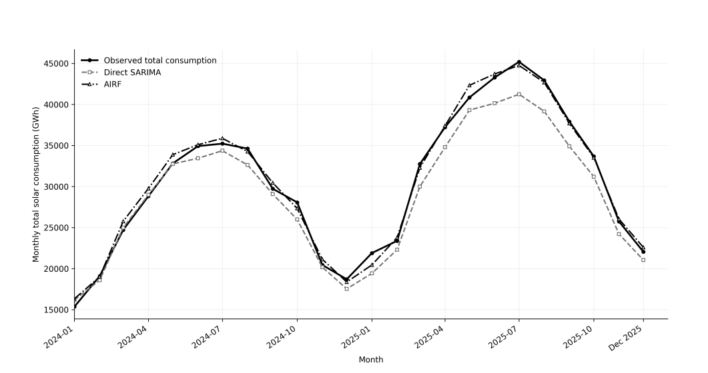

# Accounting-Identity Residual Forecasting of U.S. Solar Energy

This repository contains project information and reproducibility materials for the manuscript:

> Hasan, M., Sanjel, D., Ntow, S. A., & Uddin, S.  
> **Accounting-Identity Residual Forecasting of U.S. Solar Thermal Direct-Use Energy from U.S. Energy Information Administration Monthly Data, 2014–2025.**  
> Submitted to *Communications in Statistics – Simulation and Computation*.

## Project Overview

This study examines an accounting-identity residual forecasting (AIRF) approach for U.S. solar energy consumption.

Total solar consumption is represented as the sum of:

- Solar electricity generation
- Solar thermal direct-use energy

The AIRF approach forecasts the two components separately and then combines them to produce an accounting-coherent forecast of total solar consumption.

### Confirmatory Forecast Comparison

**Figure 2.** Observed monthly total solar consumption compared with the training-selected Direct SARIMA forecast and the coherent AIRF forecast during the 2024–2025 test period.
## Data

The analysis uses 144 monthly observations from January 2014 through December 2025.

The primary data sources are archived extracts from the U.S. Energy Information Administration Monthly Energy Review:

- Table 10.5: Solar Energy Consumption
- Table 10.6: Solar Electricity Net Generation

## Methods

The study compares statistical, machine-learning, and neural forecasting methods, including:

- Seasonal naive forecasting
- Exponential smoothing
- SARIMA
- Vector error-correction models
- Random forest
- Gradient boosting
- XGBoost
- LightGBM
- Multilayer perceptron
- LSTM
- N-BEATS-lite

Model selection is performed using expanding-window validation within the 2014–2023 training period. Final evaluation is conducted using the 2024–2025 test period.

## Repository Status

The manuscript was submitted to *Communications in Statistics – Simulation and Computation* and is currently with the editor.

Additional code, data documentation, tables, and figures will be added with the approval of all coauthors and in accordance with the journal’s policies.

## Authors

- Mahmudul Hasan
- Deepak Sanjel
- Saviour A. Ntow
- Salah Uddin

## Contact

**Salah Uddin**  
M.S. Student in Applied Statistics  
Minnesota State University, Mankato  
Email: salah.uddin@mnsu.edu
